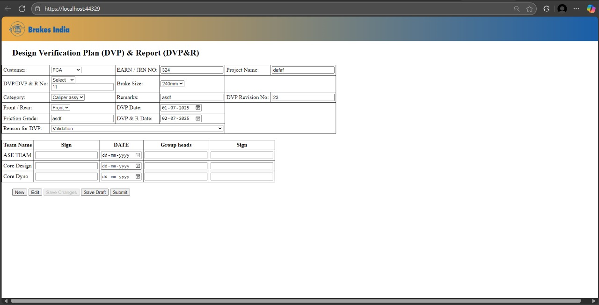
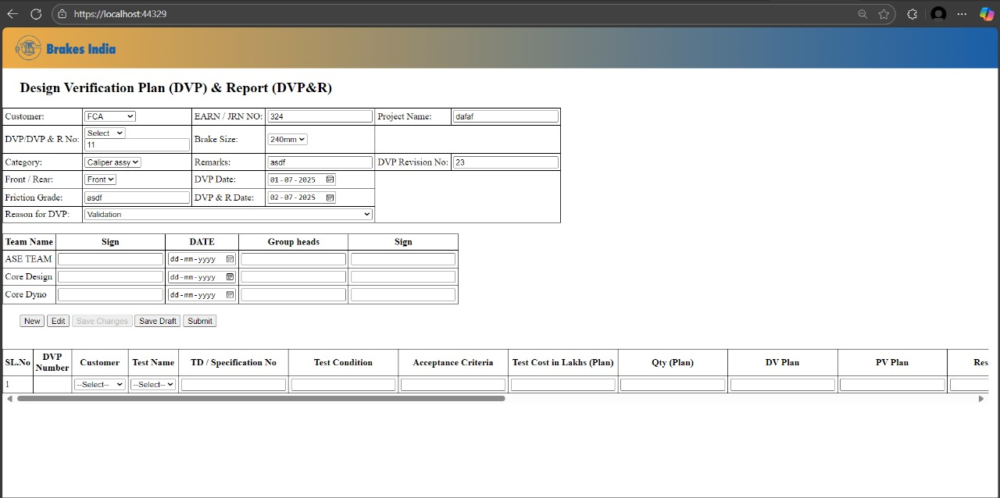
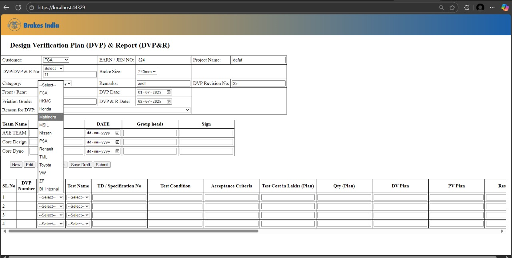
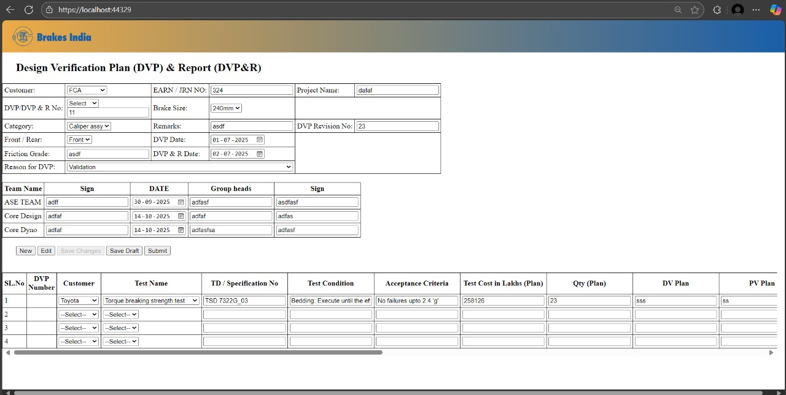
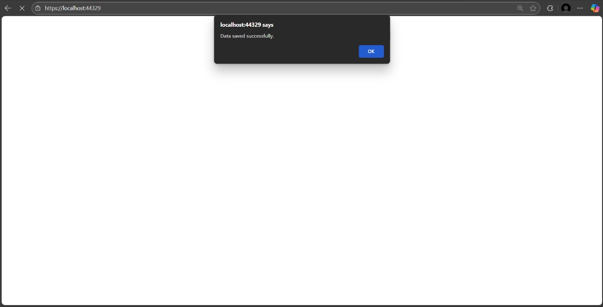

# 🧠 Design Verification Plan (DVP) Web Application

A web-based platform designed to **create, verify, and manage design verification plans**, built using **React**, **Spring Boot**, and **PostgreSQL**.
It enables teams to efficiently handle **test case tracking**, **requirement validation**, and **approval workflows**, ensuring complete design verification coverage.

---

## 📋 Features

* ✅ **React frontend** for an interactive and intuitive UI
* ✅ **Spring Boot backend** providing secure API endpoints
* ✅ **PostgreSQL database** to manage requirements, verification plans, and test results
* ✅ **RESTful APIs** for seamless frontend-backend communication
* 🚀 **Future Enhancements**: Report Generation, Role-based Access, and Automated Validation

---

## 🛠 Prerequisites

Ensure the following tools are installed before setting up the project:

* **Java 17+** → [Download](https://adoptium.net/)
* **PostgreSQL** → [Download](https://www.postgresql.org/download/)
* **Node.js & npm** → [Download](https://nodejs.org/)
* **Spring Boot CLI (Optional)** → [Guide](https://spring.io/guides/gs/spring-boot/)

---

## 🚀 Installation & Setup

### 🔹 Step 1: Clone the Repository

```sh
git clone https://github.com/Sandeep-G-S/DVP-Web-Application.git
```

### 🔹 Step 2: Configure the Database

1. Open **PostgreSQL** and create a new database:

   ```sql
   CREATE DATABASE dvpDb;
   ```
2. Update **application.properties** in the backend directory:

   ```properties
   spring.datasource.url=jdbc:postgresql://localhost:5432/dvpDb
   spring.datasource.username=your_username
   spring.datasource.password=your_password
   ```

---

### 🔹 Step 3: Run the Backend

```sh
cd backend
mvn spring-boot:run
```

The backend runs on **[http://localhost:8080](http://localhost:8080)**

---

### 🔹 Step 4: Run the Frontend

```sh
cd frontend
npm install
npm start
```

The frontend runs on **[http://localhost:5174](http://localhost:5174)**

---

## 📷 Process Flow

| **Step 1** | **Step 2** | **Step 3** |
|-------------|-------------|-------------|
|  |  |  |

| **Step 4** | **Step 5** |
|-------------|-------------|
|  |  |

---

